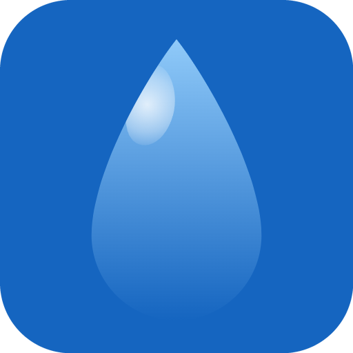
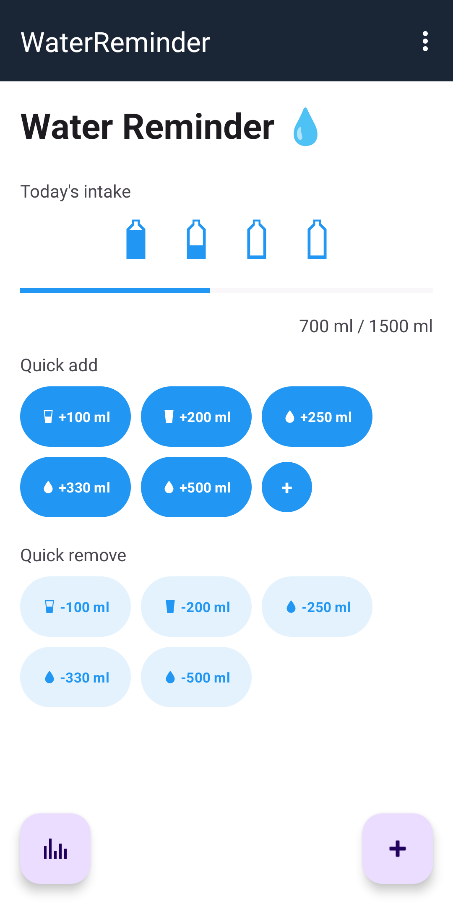
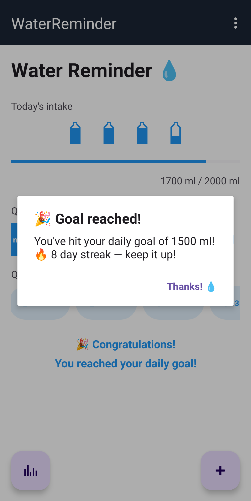
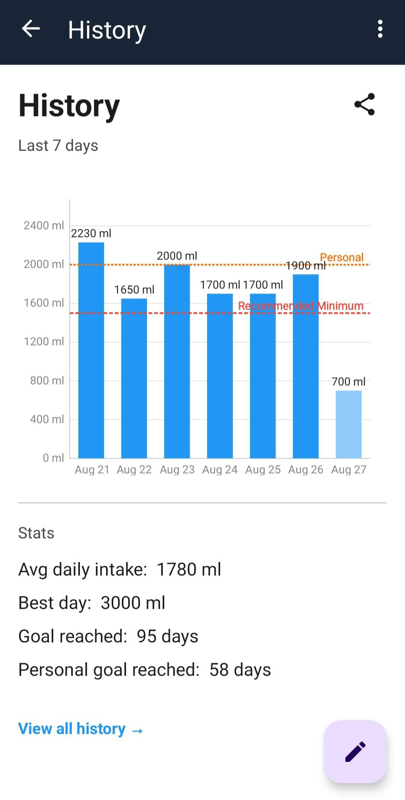

# FillMeUp!

Track your daily water intake and stay hydrated with reminders,

FillMeUp! helps you build a healthy hydration habit by tracking your daily water intake and sending you timely reminders throughout the day.

## Features:
- Log your water intake with a single tap
- Set curtomizable reminders to drink water
- View your daily and weekly hydration history with charts
- Reminders survive device reboots
- No ads, no tracking, no internet required
- Fully open source (AGPL-3.0)

## Screenshots

## Contributors

FillMeUp! is improved by community contributions. See [CONTRIBUTORS.md](CONTRIBUTORS.md) for acknowledgements.

## Installation
<!--👨‍💻 Currenty under development.-->

## Donations

