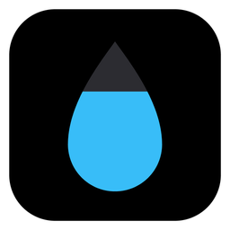
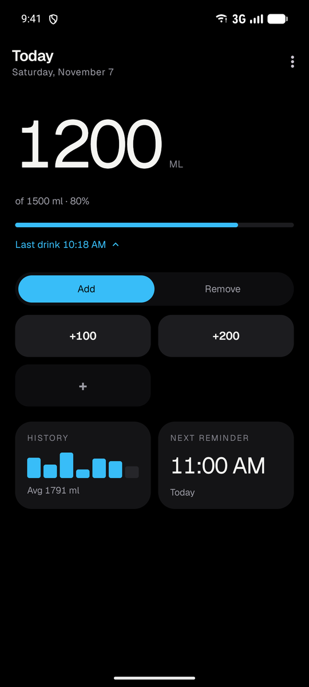
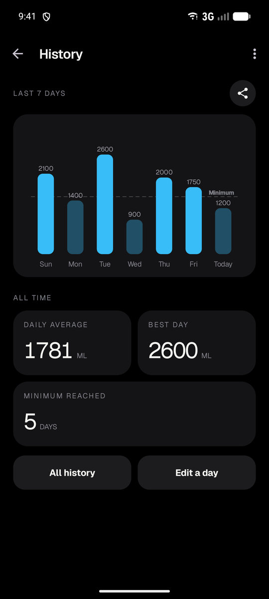
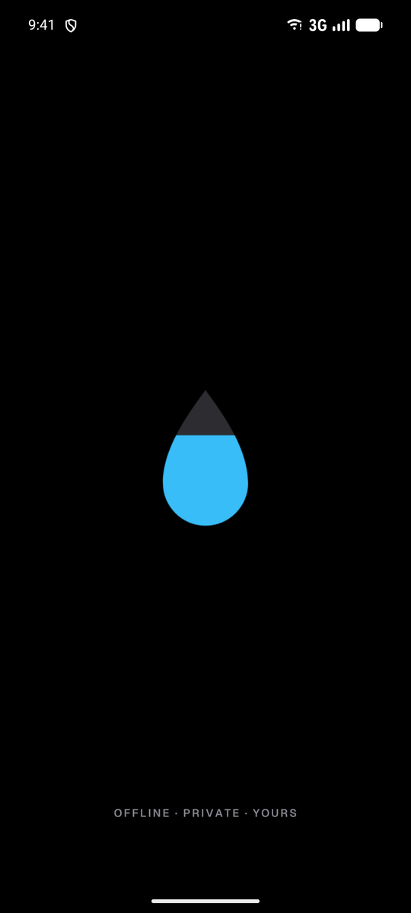

# Brim



A minimal, offline water tracker for Android. Tap what you drank, see how close you are to your goal, and get a nudge when it's time for another glass.

Brim is a redesigned fork of [FillMeUp!](https://codeberg.org/DavidCRicardo/FillMeUp) by David Ricardo. It keeps everything that works there and gives it a quieter look: true-black dark theme, the Geist typeface, big numbers and no clutter.

## Screenshots

  

## Features

- Log a drink with one tap from a grid of your own amounts, and switch to Remove to take one back
- Daily goal with a progress bar and the time of your last drink
- Today's drinks with their times, kept on your device and only until the end of the day
- Reminders on your own schedule
- The last 7 days as a chart, all-time stats and the full history, and you can correct any past day
- Home screen widgets
- Optional sync to Health Connect
- True-black dark theme by default, plus a light theme
- No ads, no account, no tracking, and no internet permission
- Free and open source (AGPL-3.0)

## Download

There is no release yet. Signed APKs will be published on the [Releases](https://github.com/4R1ST0T3L3S/brim/releases) page. Until then you can build it yourself.

## Building

Open the project in Android Studio, or use a terminal with JDK 17 or newer and the Android SDK:

```bash
./gradlew assembleDebug
```

The APK ends up in `app/build/outputs/apk/debug/`. To run the unit tests:

```bash
./gradlew testDebugUnitTest
```

## Credits

- **FillMeUp!**: © 2026 David Ricardo and contributors, released under the AGPL-3.0. Brim is a modified version of it. If you like the app, consider supporting the [original project](https://codeberg.org/DavidCRicardo/FillMeUp).
- **[Geist](https://github.com/vercel/geist-font)** typeface, © 2024 The Geist Project Authors, under the SIL Open Font License 1.1 (see [GEIST-OFL.txt](GEIST-OFL.txt)).
- **[MPAndroidChart](https://github.com/PhilJay/MPAndroidChart)** for the charts and **[TapTargetView](https://github.com/KeepSafe/TapTargetView)** for the first-run tour, both under the Apache License 2.0.

The reminder sounds bundled with the app come from [freesound.org](https://freesound.org):

| Sound | Author | Source | Licence | File |
| --- | --- | --- | --- | --- |
| water drop | IRF1010N | [freesound.org/s/661630/](https://freesound.org/s/661630/) | [CC0 1.0](https://creativecommons.org/publicdomain/zero/1.0/) | `res/raw/drop.ogg` |
| Water Drop Tap 4 | AleXZavesa | [freesound.org/s/853900/](https://freesound.org/s/853900/) | [CC BY 4.0](https://creativecommons.org/licenses/by/4.0/) | `res/raw/tap.ogg` |

Both are re-encoded to Ogg Vorbis. This table is the CC BY attribution, so it must stay intact whenever this file is rewritten. Anything added to `res/raw/` must be listed here with its licence checked first: CC BY-NC and Sampling+ are non-free licences and cannot be distributed.

## License

Brim is free software under the [GNU Affero General Public License v3.0](LICENSE), the same license as FillMeUp!.
